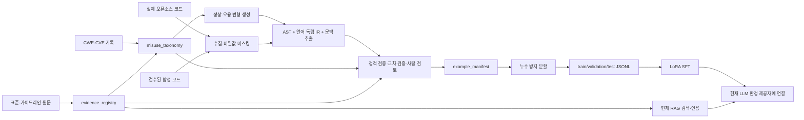

# 다언어 암호 오용 탐지 파인튜닝 데이터셋 구축 설계

- 상태: 설계 승인 후 초안
- 작성일: 2026-09-09
- 대상 저장소: `crypto-misuse-detector`
- 범위: 파인튜닝 데이터셋의 기준·구조·근거 추적·검증·RAG 연계 설계
- 제외: 이번 문서 작성 단계의 실제 코드 생성, 데이터 대량 생성, 모델 학습 실행

## 1. 목적과 설계 원칙

이 문서는 현재 문서 기반 RAG와 정적 분석 파이프라인을 유지하면서, C/C++, Python,
Java 등 여러 언어의 암호 오용 판정 데이터를 **재현 가능하고 근거를 추적할 수 있는
SFT/LoRA 학습셋**으로 구축하기 위한 설계다.

핵심 목적은 다음 네 가지다.

1. 같은 암호 오용 유형을 여러 언어·API·문맥으로 표현한다.
2. 모든 라벨을 CWE와 표준/가이드라인의 정확한 근거 조항까지 역추적한다.
3. 특정 CVE에 해당하는 실제 사례와 일반적인 합성 사례를 구분한다.
4. 현재 시스템의 `violation / clean / undetermined` 판정 계약과 바로 이어진다.

다음 원칙을 고정한다.

- 표준·가이드라인 조항은 판정 근거이고, RAG 검색 점수는 정답 라벨이 아니다.
- CWE는 약점 분류이며, CVE는 특정 제품·버전의 공개 취약점 사례다. 두 개를 같은 필드로
  취급하지 않는다.
- LLM이 근거 조항 번호, CWE, 코드 위치를 새로 지어내게 하지 않는다. 위치·규칙·인용은
  데이터와 코드가 관리하고, 모델은 문맥 판정에 집중한다.
- `undetermined`는 실패 라벨이 아니라 코드 문맥만으로 사실을 확인할 수 없다는 정답이다.
- 생성 모델의 출력은 후보일 뿐이다. 정적 분석·구조 검사·문서 검수·사람 검토를 통과한
  샘플만 학습셋에 넣는다.

## 2. 현재 상태와 계획서 대조

### 2.1 계획서가 요구하는 범위

계획서는 다음을 요구한다.

- C, C++, Python, Java 등 다언어 정상/오용 코드 수집 및 LLM 합성
- AST 및 언어 독립적 IR 변환
- API 호출부터 함수·호출자·모듈 문맥까지 Depth 0~3 추출
- 최소 1,000개 이상 코드 스니펫 확보 목표
- 정상/오용 라벨링 및 데이터 증강
- Semgrep·CodeQL·공개 모델·사람 검토를 이용한 교차 검증
- Hugging Face Transformers와 PEFT/LoRA 기반 파인튜닝

### 2.2 저장소에 이미 있는 것

현재 저장소에는 다음 자산이 있다.

- KISA 8개와 NIST 3개를 포함한 문서 지식베이스
- 파싱·청킹 결과와 현재 점검 기준 621개 문서 청크
- 82개 임계값 행과 7개 Tier-1 규칙
- Java 중심의 소규모 정상/오용 fixture
- CryptoAPI-Bench를 이용한 외부 성능 평가 코드
- `UsageSite`, `Rule`, `Citation`, `Verdict` 데이터 계약
- Java의 일부 지역 변수·필드·호출 추적과 Python의 직접 호출 추출

### 2.3 아직 없는 것

- 학습용 `train / validation / test` JSONL
- 예제별 표준 조항·CWE·CVE provenance manifest
- C/C++를 포함한 다언어 통합 AST/IR 추출기
- 문맥 Depth와 값 출처(provenance)를 표준화한 라벨 체계
- `datasets`, `peft`, `trl` 또는 `Trainer` 기반 학습 파이프라인
- 파인튜닝 어댑터를 현재 Ollama/Transformers 판정 제공자에 연결하는 경로

따라서 현재 작업은 기존 모델의 재학습이 아니라, **첫 프로젝트 전용 파인튜닝셋과 학습
경로를 새로 설계하는 일**이다.

## 3. RAG와 파인튜닝의 관계

### 3.1 현재 RAG는 학습 장치가 아니다

현재 Qdrant의 `document_chunks_v1`은 문서 본문, 페이지, section path, 파일 정보,
`needs_review` 등을 저장한다. 이는 검색·인용을 위한 색인이지 SFT 입력/정답 쌍이 아니다.
벡터와 문서 청크를 `Trainer`에 넣는다고 모델이 학습되지 않는다.

현재 흐름은 다음과 같다.

```text
코드 수집
  -> AST/정적 후보 추출
  -> 값 추적·임계값 비교
  -> RAG로 표준 조항 검색
  -> LLM에 코드 문맥 + 참고 조항 제공
  -> role/decision/reasoning/fix 판정
  -> 코드가 위치·CWE·인용을 조립해 SARIF 출력
```

인수인계 원칙대로 RAG는 근거 인용에 사용하고 탐지를 직접 촉발하지 않는다.
따라서 파인튜닝 후에도 RAG와 모델의 책임을 분리한다.

### 3.2 권장 연동 방식

첫 번째 파인튜닝 대상은 문서 검색기나 인용 생성기가 아니라 **문맥 판정기**다.

- 학습 입력에는 현재 `LlmVerdict`가 받는 것과 같은 코드 문맥, 추적된 값, 미확인 인자,
  테스트 여부, 참고 조항 블록을 넣는다.
- 학습 출력은 현재 계약과 동일하게 `role`, `decision`, `reasoning`, `fix`만 생성한다.
- CWE, 규칙 ID, 코드 위치, 표준 조항 ID, CVE ID는 `example_manifest`에 저장하고 런타임
  코드가 조립한다.
- RAG가 찾은 조항은 학습 입력의 참고 문맥으로 사용할 수 있지만, 검색 결과가 검수되지
  않았으면 gold evidence로 승격하지 않는다.
- 조항 없이 판정해야 하는 상황도 일부 넣어, 근거가 부족할 때 `undetermined`로 멈추는
  동작을 학습한다.

이 구조는 현재 설계의 “모델은 위치·규칙 번호·인용을 만들지 않는다”는 안전장치를
보존한다. 모델이 전체 SARIF나 자유 형식 인용을 생성하도록 바꾸는 것은 별도의 설계다.

### 3.3 검색기 파인튜닝은 별도 데이터셋이다

나중에 RAG 검색 품질까지 학습시키려면 SFT셋과 분리된 검색 데이터셋을 만든다.

```text
query -> positive evidence_id -> hard_negative evidence_id 목록
```

이 데이터셋은 `retriever/reranker` 학습용이며 코드 판정 SFT셋과 합치지 않는다.

## 4. 데이터셋 구성 계층

하나의 거대한 표로 합치지 않고 다음 세 개의 registry와 학습 export로 나눈다.

| 산출물 | 핵심 역할 | 모델 입력 여부 |
|---|---|---|
| `misuse_taxonomy` | 오용 유형·판정 조건·CWE·근거 후보의 정본 | 간접적으로 사용 |
| `evidence_registry` | 표준/가이드라인/CWE/CVE 근거의 원문 위치와 검수 상태 | 검수된 본문만 |
| `example_manifest` | 개별 코드 샘플과 라벨·근거·출처·검증 결과의 매핑 | 직접 입력하지 않음 |
| `train.jsonl` 등 | Qwen 계열 Chat SFT용 messages | 직접 입력 |



## 5. 오용 taxonomy와 근거 매핑

### 5.1 규칙 수준 매핑

현재 문서의 `암호가이드라인/00_가이드라인_색인.md`는 CWE와 문서 수준의 초안이다.
다음 표는 이를 데이터 생성용 정본으로 확장할 때의 시작점이다. 괄호 안의 `확정 필요`는
실제 원문에서 조항 번호·페이지·인용문을 확인하기 전에는 학습 라벨로 사용하지 않는다.

| misuse_id | 현재 rule_id | 주요 오용 | CWE 후보 | 근거 후보 | 상태 |
|---|---|---|---|---|---|
| `MISUSE-WEAK-HASH` | `CRYPTO-HASH-WEAK` | MD5/SHA-1을 보안 해시·MAC·서명에 사용 | CWE-328 | NIST SP 800-131A, KISA 알고리즘·키 길이 안내서, KISA 패스워드 안내서 | 조항 확정 필요 |
| `MISUSE-ECB` | `CRYPTO-MODE-ECB` | ECB 운영모드 사용 | CWE-327 | NIST SP 800-38A, KISA HTML5 암호기술 안내서 | 조항 확정 필요 |
| `MISUSE-OBSOLETE-CIPHER` | `CRYPTO-CIPHER-OBSOLETE` | DES/3DES/RC4 등 위험 알고리즘 사용 | CWE-327 | NIST SP 800-131A, KISA 알고리즘·키 길이 안내서 | 조항 확정 필요 |
| `MISUSE-SHORT-KEY` | `CRYPTO-KEYSIZE-SHORT` | 보안강도 미달 키 길이 | CWE-326 | NIST SP 800-131A, KISA 알고리즘·키 길이 안내서 | 임계값 표와 조항 연결 필요 |
| `MISUSE-WEAK-RNG` | `CRYPTO-RNG-INSECURE` | 키·IV·nonce에 비암호학적 난수 사용 | CWE-330 또는 CWE-338 | KISA 암호 키 관리 안내서 | **현재 CWE 충돌 해결 필요** |
| `MISUSE-HARDCODED-KEY` | `CRYPTO-KEY-HARDCODED` | 암호 키를 소스에 직접 삽입 | CWE-321 | NIST SP 800-57, KISA 암호 키 관리 안내서 | **현재 CWE 충돌 해결 필요** |
| `MISUSE-WEAK-KDF` | `CRYPTO-KDF-WEAK` | 패스워드 기반 키 유도 강도 부족 | CWE-916 | KISA 패스워드 선택 및 이용 안내서, KISA 암호 키 관리 안내서 | 조항 확정 필요 |

현재 `config/tier1_rules.json`과 문서 색인 사이에는 최소한 다음 두 불일치가 있다.

- 비암호학적 난수: 규칙 파일은 `CWE-338`, 문서 색인과 계획서의 매핑은 `CWE-330`
- 하드코딩 키: 규칙 파일은 `CWE-798`, 문서 색인과 계획서의 매핑은 `CWE-321`

이 값은 데이터 생성 전에 하나의 canonical CWE로 확정하고, 기존 규칙 파일·SARIF·문서
색인을 함께 갱신한다. 임시로 둘을 모두 정답에 넣어 모델이 CWE를 선택하게 하지 않는다.

### 5.2 증거 수준 구분

각 오용 유형은 다음 세 종류의 근거를 분리해서 저장한다.

1. **Normative evidence**: NIST/KISA 원문의 조항·표·문장. 정상/오용 기준의 직접 근거다.
2. **Weakness taxonomy**: CWE ID와 CWE 설명. 취약점 분류의 근거다.
3. **Incident evidence**: CVE ID, 영향 제품·버전, 취약점 설명·재현 코드. 실제 공개 사례와
   샘플의 관계를 설명하는 선택적 근거다.

CVE가 없는 합성 샘플은 `cve_refs: []`로 기록한다. CWE나 표준 조항이 있다고 해서 CVE를
추론하지 않는다. 실제 프로젝트 코드도 해당 CVE가 정확히 제품·버전·코드 경로와 연결될
때만 `cve_refs`를 채운다.

## 6. 근거 자료 registry 설계

### 6.1 `evidence_registry` 필드

```json
{
  "evidence_id": "EVID-NIST-800-38A-ECB-001",
  "authority_type": "standard",
  "publisher": "NIST",
  "title": "Recommendation for Block Cipher Modes of Operation",
  "document_id": "NIST.SP.800-38A",
  "revision": "2001",
  "source_uri": "...",
  "local_path": "암호가이드라인/...pdf",
  "document_sha256": "...",
  "section_path": ["...", "..."],
  "clause_id": "...",
  "page_start": 10,
  "page_end": 12,
  "table_id": null,
  "quote": "원문에서 검수한 최소 인용문",
  "quote_hash": "sha256:...",
  "normative_relation": "prohibits|requires|recommends|describes",
  "cwe_ids": ["CWE-327"],
  "verified": false,
  "verified_by": null,
  "verified_at": null,
  "license_note": "배포·인용 조건 기록"
}
```

필수 규칙:

- `clause_id` 또는 `table_id` 중 하나는 있어야 한다.
- 페이지는 실제 PDF 페이지 기준으로 기록하되, 조항이 페이지를 넘으면 범위를 기록한다.
- `section_path`, 페이지, 인용문은 원문 검수 전까지 `verified=false`다.
- OCR 청크의 `needs_review=true`를 그대로 gold evidence로 사용하지 않는다.
- 문서 해시와 버전을 기록해 가이드라인 개정 시 데이터셋을 재현한다.

### 6.2 `cve_registry` 필드

```json
{
  "cve_id": "CVE-YYYY-NNNN",
  "source_uri": "공식 CVE/NVD/MITRE 주소",
  "affected_product": "정확한 제품·컴포넌트",
  "affected_versions": ["..."],
  "relation": "derived_from|contains_pattern|reproduces|not_applicable",
  "code_reference": "샘플과 연결되는 파일·함수·커밋",
  "verified": false,
  "notes": "CWE와 표준 조항의 연결 설명"
}
```

CVE는 `evidence_registry`의 표준 조항을 대체하지 않는다. CVE가 없는 일반적인 패턴은
정상적인 데이터이며, 빈 배열이 누락을 뜻하지 않도록 스키마에서 명시한다.

## 7. 개별 코드 샘플과 학습 입력

### 7.1 `example_manifest` 필드

```json
{
  "example_id": "EX-JAVA-ECB-000001",
  "source_type": "synthetic",
  "source_uri": null,
  "source_revision": null,
  "license": "project-generated",
  "language": "java",
  "file_path": "...",
  "code_sha256": "sha256:...",
  "context_depth_available": 1,
  "context_depth_required": 1,
  "ast_format": "tree-sitter",
  "ir_version": "crypto-ir-v1",
  "provenance": ["literal_constant", "local_value"],
  "role": "crypto_operation",
  "decision": "violation",
  "rule_id": "CRYPTO-MODE-ECB",
  "cwe_ids": ["CWE-327"],
  "standard_evidence_ids": ["EVID-NIST-800-38A-ECB-001"],
  "cve_refs": [],
  "generator": {
    "kind": "llm|template|real_code|manual",
    "model": "...",
    "prompt_hash": "sha256:...",
    "seed": 0
  },
  "validation": {
    "parse": "pass",
    "compile_or_lint": "pass|not_run|fail",
    "rule_engine": "pass|disagree|not_applicable",
    "semgrep": "pass|disagree|not_run",
    "codeql": "pass|disagree|not_run",
    "human_reviewers": 2,
    "status": "approved|rejected|needs_review"
  },
  "split": "train"
}
```

코드 본문은 manifest에 직접 넣거나 별도 파일로 저장할 수 있지만, `code_sha256`과
`example_id`로 반드시 연결한다. 출처·근거·라벨의 변경 이력은 manifest에서 확인할 수
있어야 한다.

### 7.2 SFT JSONL 형식

현재 판정 프롬프트와 호환되는 기본 export는 다음 형태로 한다.

```json
{
  "example_id": "EX-JAVA-ECB-000001",
  "messages": [
    {
      "role": "system",
      "content": "암호 API 사용 문맥을 읽고 role과 decision을 판정한다. 모르는 값은 추측하지 않는다."
    },
    {
      "role": "user",
      "content": "[언어] java\n[규칙] CRYPTO-MODE-ECB (CWE-327)\n[문맥 깊이] 1\n[참고 조항]\n...\n[코드]\nCipher.getInstance(\\\"AES/ECB/PKCS5Padding\\\");"
    },
    {
      "role": "assistant",
      "content": "role: crypto_operation\ndecision: violation\nreasoning: 실제 암호 연산에 ECB 변환을 사용한다. 동일한 평문 블록의 패턴이 노출될 수 있다.\nfix: GCM 또는 CCM과 같이 인증된 운영모드로 교체한다."
    }
  ]
}
```

학습 출력은 현재 `_parse_lines`가 읽는 키와 일치시킨다.

- 허용 role: `crypto_operation`, `name_list`, `config_value`, `test_fixture`,
  `documentation`
- decision: `violation`, `clean`, `undetermined`
- `reasoning`: 코드에서 확인 가능한 사실만 기술
- `fix`: 위반일 때만 작성

근거 조항·CWE·CVE를 assistant 출력에 넣지 않는 이유는 현재 코드가 그것들을 별도로
검증·조립하기 때문이다. 다만 `example_id`로 manifest와 연결되어야 한다.

## 8. 다언어 AST/IR와 문맥 설계

### 8.1 언어 범위

1차 구축 언어는 계획서에 맞춰 C/C++, Python, Java로 한다. 데이터 스키마는 언어 확장이
가능하도록 만들고, WebCrypto/JavaScript는 별도 coverage row로 추가한다.

언어별로 API 이름은 달라도 의미 레코드는 통일한다.

```json
{
  "language": "python",
  "api": "AES.new",
  "operation": "encrypt",
  "algorithm": "AES",
  "mode": "ECB",
  "key_source": "function_parameter",
  "iv_source": "not_applicable",
  "random_source": null,
  "sink": "cipher_initialization",
  "line": 12
}
```

이 `crypto-ir-v1`은 LLVM IR을 의미하지 않는다. 언어별 AST에서 암호 오용 판정에 필요한
의미만 추출한 프로젝트 표준 IR이다. 실제 AST와 IR 모두 원본 코드 해시·라인 매핑을
보존한다.

### 8.2 문맥 depth

| depth | 입력 문맥 | 대표 판정 |
|---:|---|---|
| 0 | API 호출 한 줄 | 명백한 ECB·MD5·취약 알고리즘 |
| 1 | 호출 함수/메서드 전체 | 지역 변수, 파라미터, 테스트 여부 |
| 2 | 호출자·호출 대상과 파일 내 데이터 흐름 | 키·IV·난수 출처, 호출 인자 |
| 3 | 모듈·파일·import·설정·환경 경계 | 외부 설정, 전역 값, 프로젝트 문맥 |

각 샘플에는 `context_depth_available`과 `context_depth_required`를 모두 기록한다.
필요 depth보다 낮은 입력만 제공된 경우 정답은 보통 `undetermined`다. 억지로
`clean`이나 `violation`으로 라벨링하지 않는다.

### 8.3 문맥 판정 샘플 설계

같은 API를 서로 다른 의미로 사용하는 대조쌍을 의도적으로 만든다.

| 상황 | 정답 |
|---|---|
| 실제 해시 연산에 MD5 사용 | `violation` |
| 알고리즘 이름 목록에 MD5만 저장 | `clean` + `name_list` |
| 주석·문서 문자열의 ECB 언급 | `clean` + `documentation` |
| 테스트 fixture의 고정 키 | `clean` + `test_fixture` |
| 운영 코드의 고정 키 | `violation` |
| `SecureRandom`으로 키·IV 생성 | `clean` |
| `Random`으로 키·IV 생성 | `violation` |
| 외부 설정의 변환 문자열을 현재 문맥에서 확인하지 못함 | `undetermined` |
| 호출자가 GCM 값을 넘김 | `clean` |
| 호출자가 ECB 값을 넘김 | `violation` |

현재 파이프라인은 Java에서 일부 값 추적을 수행하고, Python은 직접 호출 추출 수준이다.
따라서 데이터셋의 다언어 depth 레코드와 실제 런타임 extractor coverage를 별도로 관리한다.
학습 데이터에 언어가 있다고 해서 현재 탐지기가 그 언어를 자동으로 분석할 수 있는 것은
아니다.

### 8.4 provenance ontology

최소한 다음 출처값을 사용한다.

`literal_constant`, `secure_random`, `weak_random`, `function_parameter`, `local_value`,
`same_file_call`, `cross_file_call`, `environment`, `config_file`, `external_input`,
`test_fixture`, `documentation`, `unknown`.

provenance는 설명용 문자열이 아니라 라벨 검증과 `undetermined` 결정에 쓰는 구조 필드다.

## 9. 데이터 수집·생성 전략

### 9.1 실제 코드

- 라이선스가 확인된 GitHub 프로젝트에서 암호 API 사용 지점을 수집한다.
- 저장소 URL, 커밋, 파일 경로, 라이선스, 코드 해시를 기록한다.
- 비밀키·토큰·개인정보·실제 인증정보는 마스킹하거나 제외한다.
- 동일 저장소·동일 커밋·복사된 함수는 fingerprint로 중복 제거한다.
- 실제 코드의 라벨은 API 이름만으로 확정하지 않고 문맥·값 출처·근거 조항을 검토한다.

### 9.2 외부 벤치마크

CryptoAPI-Bench는 우선 외부 평가셋으로 보존한다. 학습에 재사용할 경우에도 원래 평가
셋과 겹치지 않는 별도 subset과 라이선스를 확인하고, benchmark integrity를 깨지 않도록
고정된 holdout을 남긴다. 현재 `tools/benchmark.py`의 디렉터리명·`Corrected` 파일명
규칙은 평가용 정답 생성 로직이지 파인튜닝 라벨 registry가 아니다.

### 9.3 정상·오용 합성

합성은 `misuse_taxonomy`와 검수된 `evidence_registry`를 조건으로 실행한다.

- 정상 코드: 기준을 만족하는 알고리즘·키 길이·모드·난수·키 보관 방식을 변주한다.
- 오용 코드: 하나의 오용 원인을 유지한 채 알고리즘·API·변수명·제어흐름·문맥을 변주한다.
- 경계 사례: 안전한 API이지만 잘못된 사용 목적, 안전한 값과 위험한 값의 혼합, 외부 설정,
  테스트·문서 코드를 포함한다.
- 각 생성 요청은 `evidence_id`, 목표 `misuse_id`, 언어, depth, 변형 파라미터를 갖는다.
- LLM 생성 결과는 `generator`로 표시하고, 생성 모델의 설명을 라벨 근거로 사용하지 않는다.

## 10. 품질 검증과 라벨 승인

학습셋 승인 상태는 `approved` 하나로 끝내지 않고 검증 결과를 남긴다.

1. **구조 검증**: JSON schema, UTF-8, 필수 필드, example ID 중복, 메시지 형식
2. **언어 검증**: AST 파싱, 가능한 경우 compile/lint, 코드 블록과 line mapping
3. **의미 검증**: `crypto-ir` 필드와 코드의 API·알고리즘·키·IV·난수 출처 대조
4. **규칙 교차 검증**: 현재 Tier-1 규칙, Semgrep/CodeQL, 공개 도구 결과를 비교
5. **근거 검증**: evidence가 `verified=true`이고 정확한 조항·페이지·인용문·문서 해시를 가짐
6. **사람 검토**: 문맥·provenance·`undetermined`·도구 불일치 샘플은 2인 독립 검토
7. **민감정보 검증**: 실제 secret, token, private key, 개인정보가 남아 있지 않음
8. **중복·누수 검증**: 코드 fingerprint, 변형 lineage, 저장소·CVE·생성 seed 기준 점검

검증 도구 간 불일치는 자동으로 한쪽을 정답으로 선택하지 않고 `needs_review`로 보낸다.
특히 Semgrep·CodeQL이 못 잡았다는 사실은 샘플이 clean이라는 뜻이 아니다.

## 11. 분할 및 데이터 누수 방지

무작위 줄 단위 분할을 금지한다. 다음 단위를 group으로 묶는다.

- 같은 원본 저장소와 커밋
- 같은 함수의 정상/오용 변형쌍
- 같은 synthetic seed와 mutation lineage
- 같은 CVE 재현군
- 동일한 템플릿에서 변수명만 바꾼 샘플

권장 분할은 다음과 같다.

- `train`: 규칙·언어·API 변형을 학습
- `validation`: 학습에 사용하지 않은 변형과 일부 프로젝트
- `test`: 프로젝트·API 별칭·문맥 조합을 보류한 내부 테스트
- `external_holdout`: CryptoAPI-Bench 등 외부 평가셋

각 분할에는 violation/clean/undetermined와 언어·rule·depth가 모두 표시되며, 분포와
샘플 수는 export 시점에 manifest에서 계산한다. 숫자를 먼저 고정해 억지로 채우지 않는다.
계획서의 1,000개 목표는 총 수집 목표로 유지하되, 승인 가능한 라벨 수와 언어·규칙별
coverage를 함께 보고한다.

## 12. 학습 및 런타임 연결 설계

### 12.1 학습

1. 사전학습 코드 모델 후보를 동일 test split으로 baseline 평가한다.
2. 현재 prompt-only 결과를 baseline으로 저장한다.
3. Qwen/CodeBERT/StarCoder 후보 중 입력 길이·다언어성·GPU 자원에 맞는 모델을 선택한다.
4. Chat SFT + LoRA/PEFT로 `role/decision/reasoning/fix` 출력 계약을 학습한다.
5. `undetermined`와 clean hard negative를 충분히 포함해 과잉 신고를 방지한다.
6. test와 external holdout은 학습·튜닝에 사용하지 않는다.

### 12.2 런타임

현재 `LocalTransformersLLM`은 사전학습 모델을 `from_pretrained()`로 불러와 추론하고,
기본 `get_llm()`은 Ollama provider를 사용한다. 따라서 LoRA adapter를 실제 탐지기에
연결하려면 다음 중 하나가 별도로 필요하다.

- Transformers provider가 base model + PEFT adapter를 로드하도록 추가
- adapter를 병합한 모델을 로컬 provider가 로드하도록 추가
- Ollama 호환 배포 형식으로 변환한 뒤 model id/config를 연결

첫 구현에서는 Transformers + adapter 경로를 기준으로 하고, Ollama 배포는 별도 export
단계로 둔다. RAG의 Qdrant collection과 문서 인용 데이터는 그대로 유지한다.

## 13. 구현 순서

### Phase 0 — 근거와 taxonomy 확정

- 현재 rule/CWE 불일치 해결
- 문서별 조항·표·페이지·문서 해시 검수
- 규칙별 `evidence_id`와 정상/오용/미결정 조건 확정

### Phase 1 — 스키마와 registry

- JSON Schema 작성
- `misuse_taxonomy`, `evidence_registry`, `cve_registry`, `example_manifest` 저장 규칙
- Markdown/CSV 검토용 매핑표와 JSONL 기계 처리본 동시 제공

### Phase 2 — 다언어 추출·IR

- C/C++, Python, Java AST adapter
- `crypto-ir-v1` 공통 필드와 원본 line mapping
- Depth 0~3 context packer와 provenance 분류

### Phase 3 — 데이터 수집·합성·검증

- 실제 코드 collector
- guideline-conditioned template/LLM generator
- 정상·오용·hard negative·undetermined 생성
- 구조·규칙·정적 도구·사람 검증

### Phase 4 — split과 SFT export

- lineage/group 기반 누수 방지 분할
- 현재 `LlmVerdict` 호환 messages export
- 통계·coverage·검증 리포트 생성

### Phase 5 — LoRA와 탐지기 연결

- baseline 측정
- LoRA 학습·검증
- Transformers provider adapter 연결
- 외부 holdout과 기존 파이프라인 회귀 평가

## 14. 완료 기준

설계 구현이 완료됐다고 판단하려면 다음을 만족해야 한다.

- C/C++, Python, Java 샘플이 동일 manifest 계약으로 저장된다.
- 모든 `approved` 샘플은 하나 이상의 검수된 표준/가이드라인 evidence를 갖는다.
- CWE는 canonical taxonomy에서만 결정되며 rule 파일과 불일치하지 않는다.
- CVE가 없는 합성 샘플을 억지로 CVE에 매핑하지 않는다.
- 각 샘플에 `context_depth`, `provenance`, `decision`, `role`이 있다.
- 문맥 부족 샘플이 `undetermined`로 표현된다.
- train/validation/test가 원본·변형 lineage 단위로 분리된다.
- SFT JSONL의 assistant 출력이 현재 판정 parser 계약과 호환된다.
- evidence registry에서 예제의 표준명·버전·조항·페이지·인용문까지 역추적된다.
- 현재 RAG 인용 경로를 훼손하지 않고 파인튜닝 adapter를 교체 가능한 provider로 연결할 수 있다.
- 실제 모델 학습 전 prompt-only baseline과 외부 holdout 결과가 보존된다.

## 15. 현재 저장소와의 연결 지점

- 규칙 정본: `config/tier1_rules.json`
- 임계값과 현재 문서/페이지/표 근거: `config/tier1_thresholds.json`
- 문서 수준 CWE·가이드라인 매핑 초안: `암호가이드라인/00_가이드라인_색인.md`
- 문서 파싱·청킹 결과: `data/parsed/`, `data/chunks/`
- RAG 인용 저장: `src/rag_app/indexing/qdrant_store.py`
- 코드 문맥 판정 계약: `src/rag_app/analysis/findings.py`, `src/rag_app/analysis/verdict.py`
- 문맥 추적·RAG 결합: `src/rag_app/analysis/pipeline.py`
- 외부 평가: `tools/benchmark.py`

이 문서는 위 파일들을 기준으로 한 데이터셋 설계 문서다. 실제 조항 번호 확정, 매핑표
작성, 샘플 생성, 검증 도구 구현, LoRA 학습은 후속 작업으로 진행한다.
